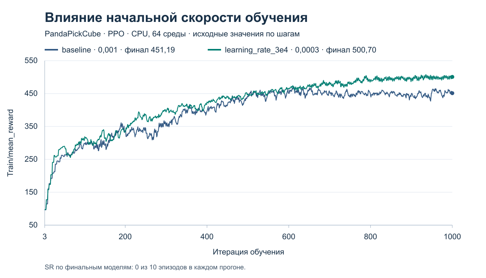

# Практика 2. Эксперименты с обучением PandaPickCube

Сравнили базовый PPO и четыре варианта, меняя по одному параметру. Во всех запусках использовали CPU, 64 параллельные среды и seed обучения 1. По умолчанию обучение шло 1001 итерацию. Для оценки использовали финальный чекпоинт, стандартную среду и 10 эпизодов с seed 42–51. Успех засчитывался, если конечное расстояние от куба до цели было строго меньше 0,05 м.

## Результаты

| Эксперимент | Изменение относительно baseline | Финальный `Train/mean_reward` | Успехи | Время |
|---|---|---:|---:|---:|
| `baseline` | Базовые настройки | 451,1874 | 0/10 | 34:13 |
| `max_iters_500` | 500 итераций вместо 1001 | 455,7856 | 0/10 | 17:15 |
| `box_target_strong` | Вес `box_target` с 8,0 до 40,0 | 674,8627 | 0/10 | 27:25 |
| `qpos_strong` | Вес `robot_target_qpos` с 0,3 до 30,0 | 4475,5859 | 0/10 | 24:46 |
| `learning_rate_3e4` | Начальный `learning_rate` с 0,001 до 0,0003 | 500,7024 | 0/10 | 27:38 |

[Наблюдения и анализ в Excel](experiment_observations.xlsx) · [Параметры обучения](training_parameters.xlsx) · [Конфигурации и результаты проверки](evidence/README.md)

[Кривая baseline](baseline_reward_curve.png) · [Сравнение числа итераций](max_iters_comparison.png) · [Сравнение весов награды](reward_comparison.png) · [Предварительная гипотеза о learning rate](learning_rate_3e4_hypothesis.md)



- При 500 итерациях обучение закончилось на 16 мин 58 с раньше baseline. Финальная награда была выше на 4,5982, успехов доставки не было.
- Усиление `box_target` и `robot_target_qpos` изменило масштаб суммарной награды. При сильном `robot_target_qpos` манипулятор почти сохранял исходную позу. В обоих прогонах захватов и доставок не было.
- При `learning_rate_3e4` финальная награда выросла на 49,5150, вопреки прогнозу о близкой или меньшей награде. Средний модуль изменения между соседними шагами снизился с 4,19 до 3,58, а на последних 200 переходах вырос с 3,46 до 4,58. SR остался 0/10. Размер обновлений политики напрямую не измерялся.

На вариант приходится один запуск обучения. Таблица описывает наблюдаемые прогоны. `Train/mean_reward` и награды отдельных эпизодов инференса измеряются в разных процедурах.

## Как проверить результаты

1. Сверьте таблицу с [точными значениями и SHA-256 моделей](evidence/runs.csv), [результатами 50 эпизодов](evidence/inference_episodes.csv) и конфигурациями в [evidence](evidence/README.md).
2. Для повторного инференса получите финальные чекпоинты из комплекта сдачи и положите их по путям из `runs.csv`. Для `max_iters_500` используется `model_499.pt`, для остальных — `model_1000.pt`.
3. Из корня репозитория запустите CPU-контейнер. В Ubuntu WSL 2 с Docker Desktop используйте команды ниже. Сборка нужна при отсутствии совместимого образа `mujoco-vnc-cpu`. Скрипт сборки использует соседний каталог `panda-wheel-cache` для пакетов и требует сетевого доступа для отсутствующих зависимостей и ресурсов симуляции. На Linux запуск выполняется через [штатный CPU-скрипт](../scripts/run_container.sh) с флагом `--cpu`.

   ```bash
   bash docs/build-cpu-wsl.sh
   bash docs/start-cpu-wsl.sh
   ```

   Проверенные версии записаны в [ограничениях CPU-образа](../docs/cpu-constraints.txt). Адаптер открывает shell в корне проекта внутри контейнера.

4. В контейнере выполните команду для нужного прогона. Для записи используйте новый путь, чтобы сохранить исходное видео.

   ```bash
   python3 inference.py --checkpoint logs/baseline/model_1000.pt \
     --device cpu --episodes 10 --seed 42 --record logs/replay/baseline.mp4
   ```

### Условия повторного обучения

Для новых прогонов используйте отдельную рабочую копию и уникальные имена каталогов. Общие параметры команды — `--device cpu --num_envs 64 --seed 1 --save_interval 50`.

| Эксперимент | Дополнительные аргументы `train.py` | Переопределение в отдельной копии скрипта |
|---|---|---|
| `baseline` | `--max_iters 1001 --exp_name replay_baseline` | Базовые настройки |
| `max_iters_500` | `--max_iters 500 --exp_name replay_max_iters_500` | Базовые настройки |
| `box_target_strong` | `--max_iters 1001 --exp_name replay_box_target_strong` | `env_cfg.reward_config.scales.box_target = 40.0` перед `registry.load` |
| `qpos_strong` | `--max_iters 1001 --exp_name replay_qpos_strong` | `env_cfg.reward_config.scales.robot_target_qpos = 30.0` перед `registry.load` |
| `learning_rate_3e4` | `--max_iters 1001 --exp_name replay_learning_rate_3e4` | `cfg_dict["algorithm"]["learning_rate"] = 0.0003` сразу после `build_runner_cfg`. Расписание остаётся `adaptive`. |

Для вариантов с переопределением запустите изменённую копию скрипта из корня отдельной рабочей копии. Для оценки всех моделей используйте штатный `inference.py` с базовыми настройками среды. Сохранённые результаты получены ранее, при подготовке материалов обучение повторно не запускалось.
